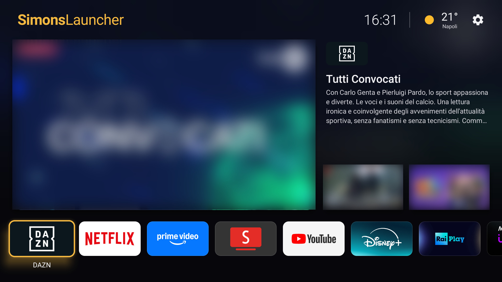
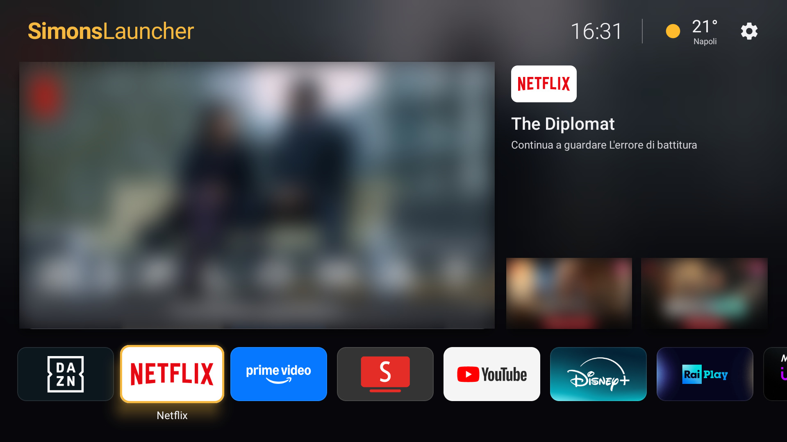
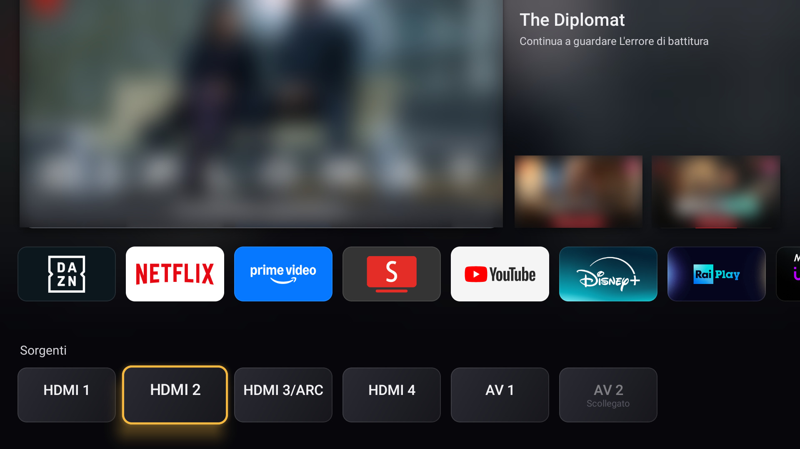
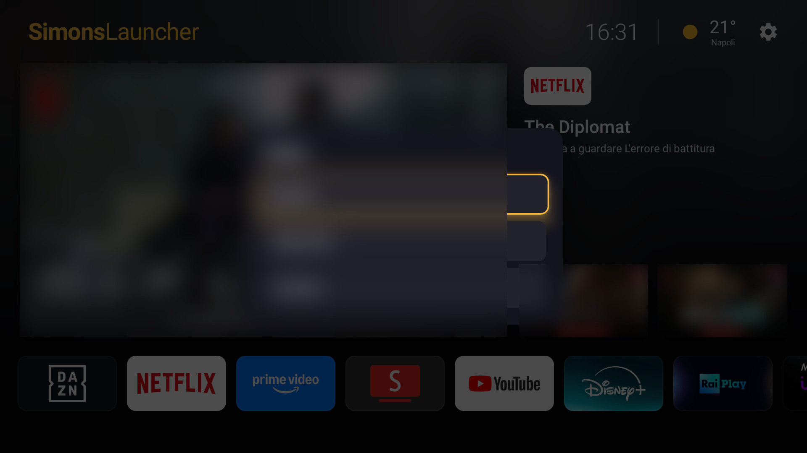

# SimonsLauncher

A fast, lightweight home screen for Android TV, built with Jetpack Compose.
Made for (and tested on) a Sony BRAVIA running Android TV 9 with 2 GB of RAM.



**Focus an app to see its titles in the spotlight**



**HDMI and AV sources, below the apps**



**Long press OK to move or hide an app**



<sub>Artwork published by the apps (posters) is blurred in these screenshots.</sub>

## Features

- **Spotlight with real titles**: shows what Netflix, Prime Video, DAZN and other apps
  publish on their Android TV preview channels (artwork, description, live badge).
  OK opens the title directly in its app.
- **App row with the official TV banners** each app ships for launchers.
  Long press OK on an app to move or hide it.
- **Sources row** (scroll below the apps): HDMI and AV inputs, with the name of the
  HDMI-CEC device when available.
- Clock, current weather (Open-Meteo, no API key), settings shortcut.
- Background that follows the focused title, D-pad focus animations and TV system sounds.
- **Safe mode**: if the launcher crashes twice at start, it opens a bare app list so the
  TV is never left without a home screen.

## Performance

Measured on a Sony BRAVIA (Android 9, 2 GB RAM): ~700 ms cold start, ~30-50 MB of RAM,
1.8 MB APK. No image-loading or UI libraries beyond Compose foundation.

## Install

Download `SimonsLauncher-<version>.apk` from the
[latest release](https://github.com/simonsruggi/simonslauncher/releases/latest), then pick one way
to get it on the TV:

- **USB stick**: copy the APK to a stick, plug it into the TV and open it with a file manager
  (e.g. *File Commander* or *X-plore* from the Play Store).
- **Downloader app** (Play Store, by AFTVnews): type the APK link and install.
- **From a computer with adb** (enable *Developer options* → *USB/network debugging* on the TV):

  ```bash
  adb connect <tv-ip>:5555
  adb install SimonsLauncher-<version>.apk
  ```

The first time, Android asks to allow installing apps from that source: allow it.

### Make it your home screen

- Press **Home** on the remote: if Android asks which home to use, choose SimonsLauncher → *Always*.
- If it doesn't ask (some TVs keep their own launcher), set it with adb:

  ```bash
  adb shell cmd package set-home-activity com.simonslauncher.app/.MainActivity
  ```

On first launch the launcher asks permission to read the titles other apps publish: allow it to
fill the spotlight.

To go back to the original launcher, uninstall SimonsLauncher or choose the other home when asked.

## Build from source

```bash
./gradlew assembleRelease
```

Requires JDK 17+ and the Android SDK. Without a release key the APK is signed with your local
debug key; it then can't update an APK downloaded from the releases (uninstall that first).

The weather location is currently hard-coded (Naples, Italy) in `WeatherClient.kt`.

## Notes

Not affiliated with any of the services it shows. App names, banners and artwork come
from the apps installed on the TV and belong to their respective owners.

## License

GPL-3.0, see [LICENSE](LICENSE). You can use, modify and share it; modified versions you distribute must stay open source under the same license.
